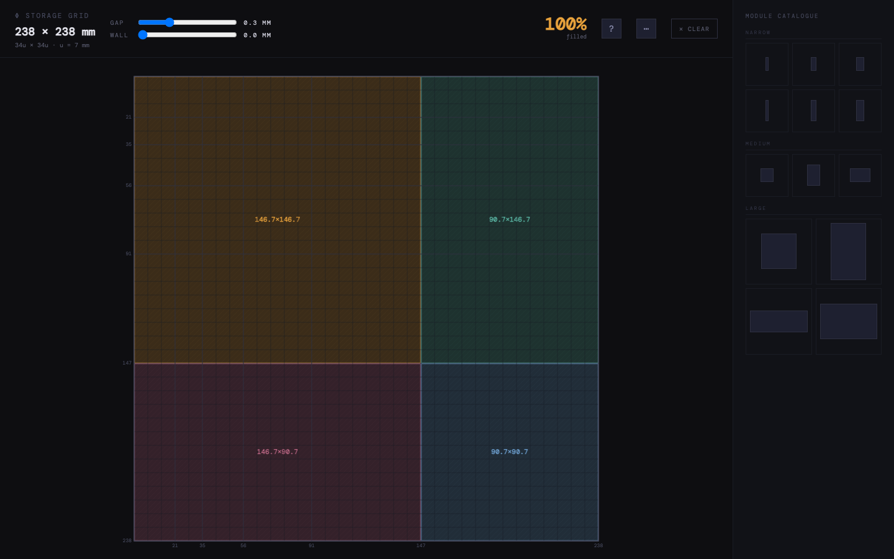

# Fib Storage Simulator

Plan a modular storage layout on a Fibonacci-based grid. Choose a module, place it on the canvas, and adjust the clearance and surrounding wall to explore how the pieces fit together.



The working area is a **34 × 34 unit grid**, with each unit measuring **7 mm**. That gives an inner area of **238 × 238 mm**. The module catalogue uses Fibonacci dimensions, and the planner prevents pieces from overlapping or extending beyond the grid.

## Use the planner

1. Select a shape from the module catalogue.
2. Move the pointer over the grid and click to place it. Right-click a placed piece to remove it.
3. Use **R** or the rotate button to rotate the selected shape. Press **Escape** to deselect it.
4. Adjust **Gap** to change the clearance between pieces, and **Wall** to adjust the surrounding frame.
5. Use the export menu to download a PNG of the canvas or a JSON or CSV description of the layout.

The toolbar shows the percentage of grid units occupied by modules. The **?** menu lists keyboard shortcuts and combinations of module widths that fill a row.
Use **Ctrl+Z** (or **Cmd+Z** on macOS) to undo a placement, removal, or clear; use **Ctrl+Shift+Z** (or **Cmd+Shift+Z**) to redo it.

Layouts and physical settings are saved in the browser's local storage. They stay in that browser and can be removed when its site data is cleared. Exported files are separate downloads.

The current interface requires a viewport at least **1024 pixels wide**; smaller screens show a notice instead of the planner.

## Run locally

Requires [Bun](https://bun.com/). From the repository directory:

```sh
bun install --frozen-lockfile
bun run dev
```

Open the local URL printed by the server. The development server uses Bun's HTML bundling and hot reload.

For a production-mode server:

```sh
bun run start
```

To create a browser build in `dist/`:

```sh
bun run build
```

The build script removes the existing output directory before writing the new build.

## Tests

```sh
bun test
```

The test suite covers grid placement, canvas sizing and drawing, exports, and persistence helpers.

## Project structure

- `src/FibGrid/components/` — canvas, toolbar, module catalogue, and viewport notice.
- `src/FibGrid/hooks/` — layout state, history, and local persistence.
- `src/FibGrid/lib/` — grid calculations, rendering, sizing, and exports.
- `src/index.ts` — Bun development and production server.
