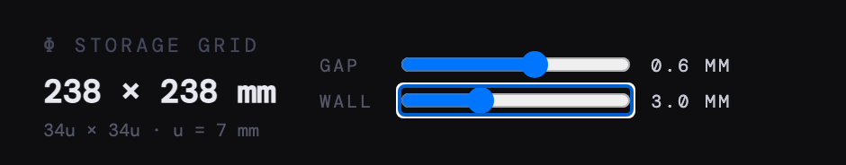

# Fib Storage Simulator

**Plan a modular storage layout before you print the parts.** Fib Storage Simulator is a small, local web app for arranging Fibonacci-sized modules on a fixed grid, exploring how they fit together, and accounting for the gaps and frame around them.

It is useful when prototyping 3D-printed storage: try different arrangements, check the occupied area, and export the dimensions without drawing each layout by hand. The app plans **2D footprints**; it does not generate printable 3D models or STL files.


_An in-progress layout: three placed modules, remaining space, and a selected module in the catalogue._

## What you can do

- **Arrange modules:** choose from 13 rectangular modules, rotate them, and place them on the grid. The planner prevents overlaps and out-of-bounds placements.
- **Check the fit:** see the filled percentage and dimensions, and adjust the clearance and outer wall for a physical assembly.
- **Keep exploring:** undo and redo placements, removals, and clearing. The current layout and settings are saved in your browser.
- **Take the plan with you:** export the canvas as PNG or the layout and dimensions as JSON or CSV.

## Grid and physical settings

The inner grid is fixed at **34 × 34 units**. One unit is **7 mm**, making the working area **238 × 238 mm**. Module dimensions use the Fibonacci unit sizes 3, 5, 8, 13, 21, and 34; the catalogue offers 13 combinations.



_The controls show the gap between pieces and the thickness of the wall outside the grid._

| Setting  | Range and default                                  | What it changes                                                                                                                                     |
| -------- | -------------------------------------------------- | --------------------------------------------------------------------------------------------------------------------------------------------------- |
| **Gap**  | 0–1 mm, in 0.1 mm steps; default **0.3 mm**        | Clearance between modules. Each module is inset by half the gap on each side, so its built width and depth are each the nominal size minus the gap. |
| **Wall** | 0–9 mm per side, in 0.5 mm steps; default **0 mm** | A frame outside the fixed inner grid. The outer size ranges from 238 × 238 mm to 256 × 256 mm.                                                      |

For example, a nominal **91 × 91 mm** module with a **0.3 mm** gap has a displayed built footprint of **90.7 × 90.7 mm**. A **3 mm** wall increases the outer footprint to **244 × 244 mm**. These are planning dimensions; choose tolerances appropriate for your own printer and materials.

## Use the planner

1. Choose a module from the catalogue on the right.
2. Move over the grid and click to place it. Right-click a placed module to remove it.
3. Press **R** or use **Rotate** to rotate the selection; press **Escape** to deselect it.
4. Adjust **Gap** and **Wall** in the toolbar. Use **?** to see shortcuts and row combinations.
5. Open the **⋯** menu to export PNG, JSON, or CSV. JSON and CSV include nominal and built dimensions and positions.

Use **Ctrl+Z** (or **Cmd+Z** on macOS) to undo and **Ctrl+Shift+Z** (or **Cmd+Shift+Z**) to redo. Your layout is stored in browser local storage and stays on that device; clearing site data removes it. Exports are separate downloads, not backups that the app can import.

The interface currently requires a viewport at least **1024 pixels wide**. Smaller screens show a notice instead of the planner.

## Run locally

Requires [Bun](https://bun.com/):

```sh
git clone https://github.com/alex-golovanov/fib-storage.git
cd fib-storage
bun install --frozen-lockfile
bun run dev
```

Open the local URL printed by the server. For a production-mode server, use `bun run start`. To create a browser build in `dist/`, use `bun run build`; the build script replaces the existing output directory.

## Development checks

```sh
bun test
bun run lint
bun run format:check
```

Run `bun run format` to apply the project's formatting. Historical design and planning documents under `docs/superpowers/` are excluded from formatting.

The application uses React and TypeScript, with Bun serving the app. The planner lives in `src/FibGrid/`: components handle the interface, hooks manage layout and persistence, and `lib/` contains grid calculations, drawing, and exports.
